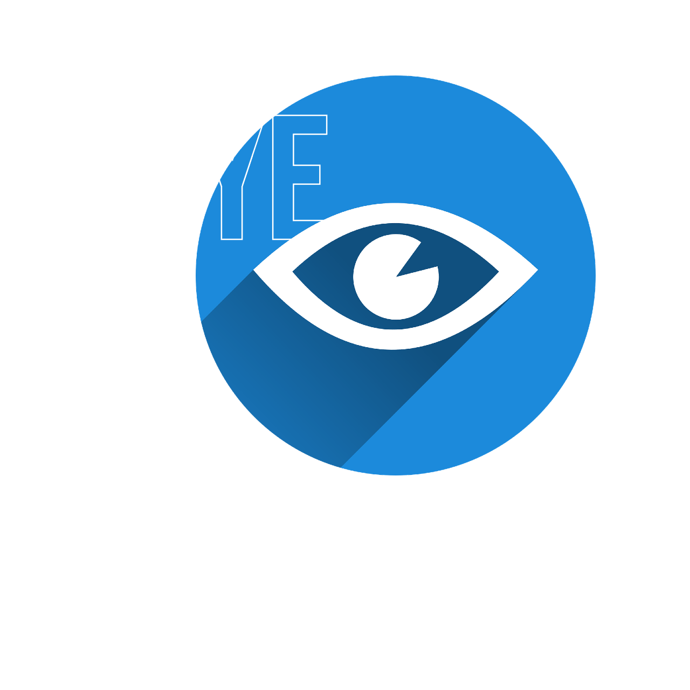

<div align="center">


# EyeBreak

### A little reminder to look away from your screen.

**EyeBreak v3 is an app to help you stay productive while taking care of your eyes using the 20-20-20 rule.**


[](LICENSE)



</div>

EyeBreak keeps track of your next eye break while you work. When it's time, a reminder and an optional sound help you follow the 20-20-20 rule.

## Small app, useful touches

- **Your own rhythm.** Adjust the work interval, break length, and remind-me-later delay.
- **Your choice of alerts.** Pick a custom sound, set the volume, or enable a tray notification.
- **Ready when you return.** The countdown pauses while Windows is locked or asleep.
- **Out of the way.** Hide the controls in the tray, start hidden, or reduce animations.

## Get started

### Windows executable

Open `dist\EyeBreak.exe` if you've already built the app. It includes everything needed to run without Python installed. Move the single executable to a writable folder; EyeBreak saves your settings beside it when you click **Save**.

To build it yourself, install Python 3.11 or newer and run these commands from the project folder:

```powershell
python -m pip install -r requirements.txt pyinstaller
python -m PyInstaller --noconfirm EyeBreak.spec
```

Your app will be in `dist\EyeBreak.exe`.

<details>
<summary>Run directly with Python</summary>

```powershell
python -m pip install -r requirements.txt
python main.py
```

Keep `defaults.ini` and the `sounds` folder beside `main.py`. To try a reminder immediately, run `python main.py --test`.

</details>

## Make it yours

Open **Settings** to adjust the timing, sound, volume, tray notifications, startup visibility, and animations. Your choices are stored in `config.txt` beside the script or executable.

Use the tray menu to show the controls, pause reminders, open Settings, or quit. To try the packaged reminder and sound immediately, run `EyeBreak.exe --test` from the folder containing it.

### Start with Windows

1. Keep `EyeBreak.exe` in the folder you want to run it from.
2. Press **Win+R**, enter `shell:startup`, and press **Enter**.
3. Place a **shortcut** to `EyeBreak.exe` in that folder.

Enable **Start hidden in the tray** in Settings if you'd like EyeBreak to stay out of the way when you sign in.

## License

[MIT](LICENSE)
